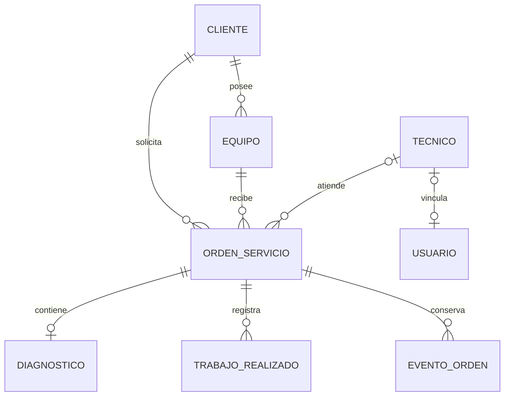

# JequeTech Solutions S.A.C.

Sistema web para la gestión y seguimiento de órdenes de servicio técnico. Implementación académica del Avance de Proyecto Final 2 del curso **Marcos de Desarrollo Web**, basada en el Avance 2 y los diagramas actualizados entregados el 28 de septiembre de 2026.

La aplicación integra **Java, Spring Boot 4.0.8, Spring Web MVC, Thymeleaf y Bootstrap 5.3.8**. Las páginas se generan en el servidor y los formularios procesan datos mediante controladores, servicios y repositorios. Bootstrap y el logo se sirven localmente: la interfaz no depende de un CDN.

## Estado del proyecto

Documentación actualizada el **20 de octubre de 2026**. Aplicación **0.1.0 / APF2**, con el primer hito del APF3 dedicado al esquema MySQL. La web sigue usando repositorios en memoria; todavía no se conecta a esta base.

| Área | Estado actual |
| --- | --- |
| Clientes y equipos | Registro, consulta y edición; historial por equipo |
| Órdenes de servicio | Registro, asignación, diagnóstico, trabajos, seguimiento y entrega |
| Usuarios y técnicos | Gestión por administrador, vinculación de cuenta y activación/desactivación |
| Acceso | Sesiones y permisos por rol comprobados en el servidor |
| Interfaz | Logo propio de la propuesta, paleta azul/turquesa y navegación responsive |
| Almacenamiento | Repositorios en memoria con datos ficticios; sin persistencia entre reinicios |
| Verificación registrada | 17 pruebas de integración aprobadas y recorrido de navegador PASS |
| Base relacional APF3 | Esquema MySQL de ocho tablas y entorno Docker independiente |
| Próximas etapas | Conectar JPA y transacciones, Spring Validator y posteriormente Spring Security |

Las imágenes de maquetación del informe son referencias de diseño. La interfaz implementada y sus capturas constituyen la evidencia de esta versión. La entrega académica del Word y la exposición se completan por separado.

## Ejecutar en Windows

Requisitos: JDK 17 o posterior compatible con Spring Boot 4.0; probado con Oracle JDK 25.0.1. Maven Wrapper incluye la configuración de Maven 3.9.12, por lo que no es necesario instalar Maven por separado. La primera compilación requiere Internet para descargar Maven y las dependencias.

Desde PowerShell, dentro de la carpeta del proyecto:

```powershell
java -version
.\mvnw.cmd spring-boot:run
```

Abrir [http://127.0.0.1:8080/login](http://127.0.0.1:8080/login). Para detener el servidor, usar `Ctrl+C` en esa terminal.

Para verificar y generar un ejecutable:

```powershell
.\mvnw.cmd clean verify
java -jar .\target\jequetech-0.1.0.jar
```

Si el puerto 8080 está ocupado, ejecutar el JAR con un puerto libre:

```powershell
java -jar .\target\jequetech-0.1.0.jar --server.port=8081
```

En ese caso, abrir `http://127.0.0.1:8081/login`. El servidor escucha únicamente en la computadora local. En macOS/Linux se utiliza `sh mvnw` en lugar de `.\mvnw.cmd`.

## Accesos de demostración

Todas las cuentas iniciales usan la contraseña **`Demo2026!`**. Son credenciales públicas para datos ficticios, no cuentas empresariales reales.

| Correo | Rol | Funciones |
| --- | --- | --- |
| `recepcion@jequetech.test` | Personal administrativo | Clientes, equipos, registro y edición de recepción, asignación, seguimiento e historial |
| `admin@jequetech.test` | Administrador | Usuarios, técnicos y consulta de órdenes |
| `tecnico@jequetech.test` | Técnico: Daniel Torres | Órdenes propias, diagnóstico, trabajos y estados |
| `ana@jequetech.test` | Técnico: Ana Ruiz | Segundo usuario para comprobar aislamiento de órdenes |

Los cambios se comparten entre las sesiones del mismo servidor y **se pierden al detenerlo**. Al reiniciar se cargan nuevamente cuatro clientes, cinco equipos, dos técnicos, cuatro cuentas y seis órdenes ficticias. No se requiere MySQL para este avance.

## Recorrido funcional

1. Ingresar como recepción. Registrar o seleccionar un cliente y un equipo de su propiedad.
2. Registrar una orden: nace en **Registrada**, sin técnico. El detalle confirma la operación.
3. Asignar un técnico activo con cuenta habilitada: cambia a **Asignada**.
4. Ingresar con el técnico asignado y guardar el diagnóstico: cambia a **En diagnóstico**.
5. Registrar el primer trabajo: cambia a **En atención**. Se pueden añadir varios trabajos.
6. Confirmar **Finalizada** mediante el modal; luego confirmar **Entregada**. El historial conserva las operaciones y su autor.
7. Desde recepción, abrir **Equipos → Historial** para consultar únicamente las órdenes de ese equipo.

Los roles se comprueban en el servidor. Un técnico no puede consultar ni modificar órdenes de otro técnico. El administrador no sustituye las funciones de recepción. Una cuenta desactivada pierde acceso en la siguiente solicitud.

Se comprueban campos obligatorios, longitudes, correo/teléfono, documentos y series duplicados, pertenencia del equipo al cliente, fecha no futura, técnico disponible, secuencia de estados y versión de la orden. La recepción y la asignación se editan antes de iniciar el diagnóstico. No hay eliminación de registros en APF2.

## Estructura

```text
src/main/java/pe/jequetech/
  JequetechApplication.java
  config/                 Servidor web, sesión, repositorios y semilla ficticia
  controller/             Rutas HTTP y preparación de las vistas
    form/                 Objetos de los formularios
  service/                Reglas de negocio y coordinación
  model/                  Usuario, Cliente, Equipo, Tecnico, OrdenServicio,
                          Diagnostico, TrabajoRealizado y valores auxiliares
  repository/             Contratos de almacenamiento
    memory/               Adaptadores temporales en memoria
src/main/resources/
  templates/              Vistas Thymeleaf y fragmentos compartidos
  static/css/             Identidad y adaptación responsive
  static/js/              Filtrado de equipos y formulario de usuarios
  static/img/             Logo y favicon
  static/vendor/          Bootstrap y licencia MIT
src/test/java/             Pruebas de integración y reglas de negocio
scripts/                  Comprobación de navegador y empaquetado
docs/                     Alcance, evidencias y continuidad académica
```

El README es el punto de entrada de la documentación. Los documentos de `docs/` desarrollan temas específicos sin añadir otros README. El logo principal se conserva en `src/main/resources/static/img/`; su guía y prompt están en `docs/identidad/`.

`target/` contiene el ejecutable y los resultados generados por Maven; `exports/` contiene el ZIP y las evidencias del navegador. Ambas carpetas están excluidas del control de versiones. `tmp/` está reservado para trabajo temporal y no es necesario para ejecutar ni compilar el proyecto. La carpeta `.github/modernize/` contiene archivos auxiliares de la herramienta de modernización del IDE; no forma parte de la aplicación ni del paquete académico.

Los scripts mantenidos son `check-browser.cjs` (verificación visual y funcional), `package.ps1` (entrega de fuentes) y `download-bootstrap.cjs` (reposición de los recursos Bootstrap 5.3.8 y su licencia). Este último se ejecuta con Node desde la raíz y requiere Internet; no es necesario durante el uso normal.

## Rutas principales

| Método | Ruta | Finalidad |
| --- | --- | --- |
| GET / POST | `/login` | Formulario e inicio de sesión |
| POST | `/logout` | Cierre de sesión |
| GET | `/dashboard` | Indicadores calculados según el usuario |
| GET / POST | `/ordenes` | Consulta con búsqueda/filtros y registro |
| GET | `/ordenes/nueva` | Formulario de recepción |
| GET | `/ordenes/{id}` | Detalle y seguimiento |
| GET / POST | `/ordenes/{id}/editar` | Edición previa al diagnóstico |
| POST | `/ordenes/{id}/asignar` | Asignación de técnico |
| POST | `/ordenes/{id}/diagnostico` | Registro/actualización del diagnóstico |
| POST | `/ordenes/{id}/trabajos` | Registro de una actividad técnica |
| POST | `/ordenes/{id}/estado` | Confirmación del siguiente estado permitido |
| GET | `/seguimiento` | Consulta de avance para recepción |
| GET | `/equipos/{id}/historial` | CU-14, historial exacto del equipo |
| GET / POST | `/clientes`, `/equipos`, `/tecnicos`, `/usuarios` | Listado y registro |
| GET | `/{directorio}/nuevo` | Formulario del directorio correspondiente |
| GET / POST | `/{directorio}/{id}/editar` | Edición del registro |

## Pruebas y evidencias

```powershell
.\mvnw.cmd verify
```

La comprobación opcional en navegador requiere Node.js, Playwright y Microsoft Edge. Con Playwright disponible como módulo, iniciar primero el servidor y ejecutar desde otra terminal:

```powershell
node .\scripts\check-browser.cjs
```

El script crea datos ficticios de prueba, recorre los roles y guarda capturas en `exports/evidencias/`. Puede configurarse `PLAYWRIGHT_MODULE` con la ruta de un módulo Playwright ya instalado, `BASE_URL` con otro puerto y `BROWSER_CHANNEL` con el navegador compatible. No se necesita Node para ejecutar la aplicación Java. Reiniciar el servidor al terminar las pruebas para recuperar la demostración inicial.

Consultar [la guía de evidencias](docs/EVIDENCIAS-APF2.md), [las decisiones de alcance](docs/ALCANCE-APF2.md) y [el resultado de verificación](docs/VERIFICACION.md).

### Última verificación registrada

Resultados del 28 de septiembre de 2026; corresponden a la ejecución documentada, no a pruebas ejecutadas automáticamente al leer este archivo:

- **Maven:** 17 pruebas, 0 fallos, 0 errores y 0 omitidas; compilación `BUILD SUCCESS`.
- **Navegador:** ocho grupos de comprobaciones con resultado `PASS`, incluidos el ciclo completo de una orden, los permisos por rol y la desactivación de cuentas.
- **Responsive:** anchos de 390, 768, 1366 y 1920 píxeles; se generaron 23 capturas y se revisaron ejemplos de las vistas principales, el menú móvil y el modal.
- **Informes locales:** `target/surefire-reports/pe.jequetech.AplicacionTest.txt` y `exports/evidencias/resultado-navegador.json`. Las capturas están en `exports/evidencias/`.

Los informes de pruebas y las capturas son archivos generados y no forman parte del ZIP de fuentes. Se pueden regenerar con los comandos anteriores.

## Configuración y problemas frecuentes

La configuración está en `src/main/resources/application.properties`: dirección local `127.0.0.1`, puerto `8080` (o variable `PORT`) y sesión de 30 minutos. Para trabajar con otro puerto de forma puntual, usar el argumento `--server.port` mostrado arriba.

| Situación | Acción |
| --- | --- |
| `java` no se reconoce | Instalar/configurar el JDK y comprobar `java -version` desde una nueva terminal |
| La primera compilación no descarga dependencias | Comprobar la conexión y la configuración de proxy del entorno; volver a ejecutar Maven Wrapper |
| El puerto 8080 está ocupado | Usar otro puerto libre y abrir la URL correspondiente |
| No aparece el JAR | Ejecutar `.\mvnw.cmd clean verify` y comprobar que termina con `BUILD SUCCESS` |
| Los datos vuelven a su estado inicial | Es el comportamiento del almacenamiento en memoria al reiniciar |
| Una cuenta no puede entrar | Comprobar sus credenciales y estado activo; para un técnico, también su vinculación y estado |
| La prueba de navegador no encuentra Playwright | Configurar `PLAYWRIGHT_MODULE` con la ruta del módulo instalado; esta dependencia solo se usa para la prueba opcional |

## Documentación del proyecto

| Documento | Contenido |
| --- | --- |
| [Alcance APF2](docs/ALCANCE-APF2.md) | Casos de uso, decisiones de implementación, exclusiones y relación con la rúbrica |
| [Evidencias APF2](docs/EVIDENCIAS-APF2.md) | Capturas que incorporar al informe y recorrido para la exposición |
| [Verificación](docs/VERIFICACION.md) | Entorno, resultados, cobertura y límites de las comprobaciones |
| [Guía visual](docs/identidad/GUIA-VISUAL.md) | Logo, paleta y criterios de identidad visual |

## Continuidad

El APF3 se desarrolla por hitos, cada uno con su verificación y commit local:

1. **Esquema relacional MySQL:** ocho tablas, relaciones, restricciones, índices y prueba de integridad y reinicio. Implementado en este hito.
2. **Persistencia de la aplicación:** entidades y adaptadores JPA/Hibernate, transacciones, generación de identificadores, bloqueo optimista y semilla que no sobrescriba registros. Pendiente.
3. **Validación y cierre APF3:** Spring Validator, operaciones restantes según rúbrica y evidencias del recorrido persistente. Pendiente.

Los contratos de repositorio permiten sustituir la memoria sin trasladar las reglas de negocio a los controladores. Hasta completar el segundo hito, registrar datos desde la web no escribe en MySQL.

La fase final incorporará Spring Security, autenticación y autorización formales, pruebas de seguridad y despliegue adecuado. El acceso actual es una demostración de sesión con contraseñas derivadas mediante PBKDF2 y token antifalsificación; no equivale a la implementación final de Spring Security. JWT solo se incorporará si la arquitectura y las indicaciones del curso lo requieren.

El informe Word original se conserva sin modificaciones. Las capturas, la exposición, el Project Charter y el DER deben revisarse y completarse en su entrega académica correspondiente. No se afirma una calificación ni el cumplimiento del proyecto final.

## MySQL — hito 1 del APF3

Archivos: [esquema](database/schema.sql), [pruebas SQL](database/tests/integridad.sql), [Compose](compose.yaml) y [prueba automatizada](scripts/check-database.ps1).



El técnico puede existir sin cuenta durante el alta. Todo usuario con rol `TECNICO` exige un técnico vinculado; los demás roles no admiten ese vínculo. La relación compuesta equipo–cliente impide registrar una orden para un equipo ajeno o cambiar el propietario de un equipo con órdenes.

El esquema utiliza InnoDB, claves autoincrementales y `utf8mb4_0900_as_ci` (distingue acentos e ignora mayúsculas). El diagnóstico comparte la clave de su orden. Trabajos y eventos tienen identificador global y número único dentro de cada orden. El autor del evento se conserva como texto histórico. No hay borrados en cascada. La columna `version` prepara la detección de escrituras obsoletas; el siguiente hito implementará `@Version` y las transacciones en JPA.

Las comprobaciones entre registros —cuenta y técnico activos, secuencia de estados, diagnóstico y trabajo previos a finalizar— siguen siendo responsabilidad del servicio. Las fechas futuras se validan allí. Las restricciones SQL no sustituyen esas reglas ni aplican por sí solas un flujo de atención.

### Levantar la base local

Requiere Docker Desktop con contenedores Linux. Desde la raíz:

```powershell
Copy-Item .env.example .env
```

Editar `.env` y completar `MYSQL_ROOT_PASSWORD` y `MYSQL_PASSWORD` con contraseñas locales distintas. `MYSQL_PORT` vale `3307` por defecto y puede cambiarse si está ocupado. `.env` queda excluido de Git y del ZIP.

```powershell
docker compose up -d --wait
docker compose ps
docker compose exec mysql mysql -u jequetech -p jequetech
```

El último comando solicita la contraseña de `MYSQL_PASSWORD`. Desde un cliente externo, usar `127.0.0.1:3307`, base y usuario `jequetech`. Se publica solo en la interfaz local. La imagen está fijada por digest para reproducir la prueba.

La inicialización ejecuta `database/schema.sql` únicamente cuando el volumen está vacío. No crea cuentas web ni carga datos demo. `docker compose stop` detiene la base; `docker compose start --wait` la inicia conservando el volumen. `docker compose down` retira el contenedor y la red, conservando los datos. Añadir `-v` eliminaría el volumen y sus datos: no es necesario para el uso normal.

Modificar el SQL no actualiza automáticamente una base existente. Los cambios posteriores necesitarán migraciones; este script inicial falla ante tablas existentes para evitar aparentar una actualización que no realizó. No contiene `DROP TABLE`.

### Comprobar el esquema sin afectar bases existentes

```powershell
.\scripts\check-database.ps1
```

La prueba usa un contenedor de nombre único, contraseña aleatoria, sin puertos publicados y sin utilizar `.env`. Crea el esquema, verifica restricciones y rollback, y comprueba que un dato confirmado sobrevive al reinicio de MySQL. Al terminar elimina únicamente su contenedor y volumen efímeros. No prueba aún la persistencia de la web.

## Preparar entrega

```powershell
.\scripts\package.ps1
```

Genera `exports/jequetech-fuentes.zip` con código, wrapper, recursos, documentación y base relacional del hito actual. Excluye `.env`, cachés, archivos temporales, capturas y resultados de compilación. La copia `JequeTech-APF2-Docente` y el ZIP APF2 anteriores se conservan como entregas históricas y no se actualizan automáticamente. El JAR ejecutable se obtiene con `verify` y puede entregarse por separado si el docente lo solicita.

Ejecutar nuevamente el empaquetado después de modificar código o documentación para mantener el ZIP sincronizado. Para usarlo en otra computadora, extraerlo en una carpeta y seguir la sección **Ejecutar en Windows**. El paquete no incluye un JDK ni las dependencias de Maven descargadas.

## Referencias técnicas

- [Spring Boot: requisitos del sistema](https://docs.spring.io/spring-boot/4.0/system-requirements.html).
- [Bootstrap 5.3: descarga y distribución](https://getbootstrap.com/docs/5.3/getting-started/download/). Se conserva su licencia MIT en `static/vendor/`.
- [MySQL 8.4: creación de tablas y restricciones](https://dev.mysql.com/doc/refman/8.4/en/create-table.html) e [inicialización de la imagen oficial](https://hub.docker.com/_/mysql).
- El logo fue generado específicamente para esta propuesta mediante image_gen; el prompt y la guía de color están en `docs/identidad/`. No se ha verificado exclusividad registral de marca.
